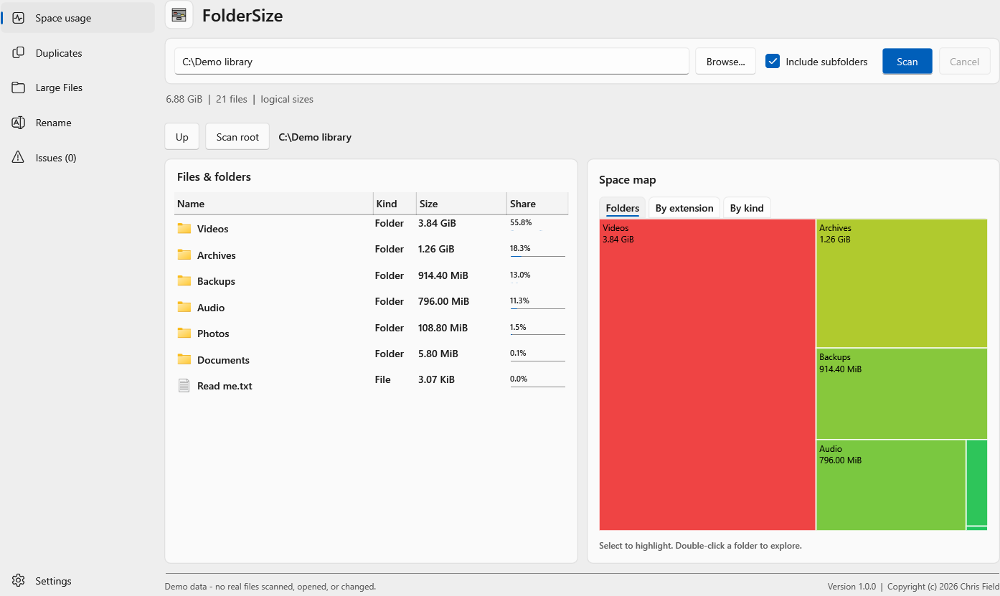
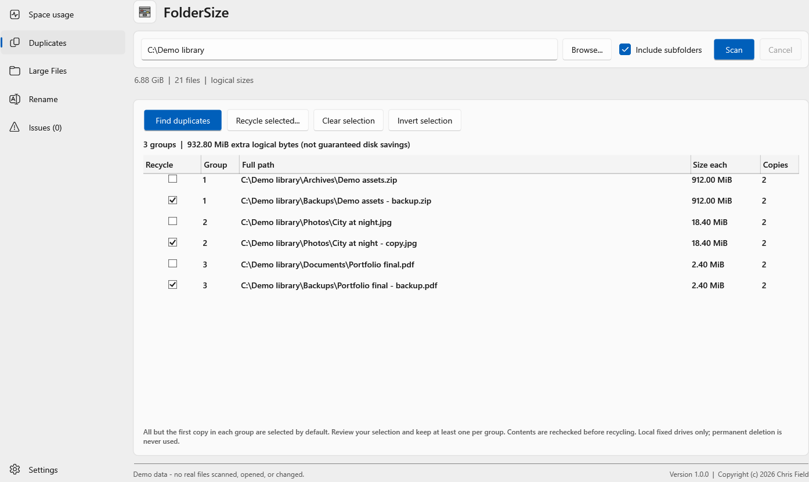
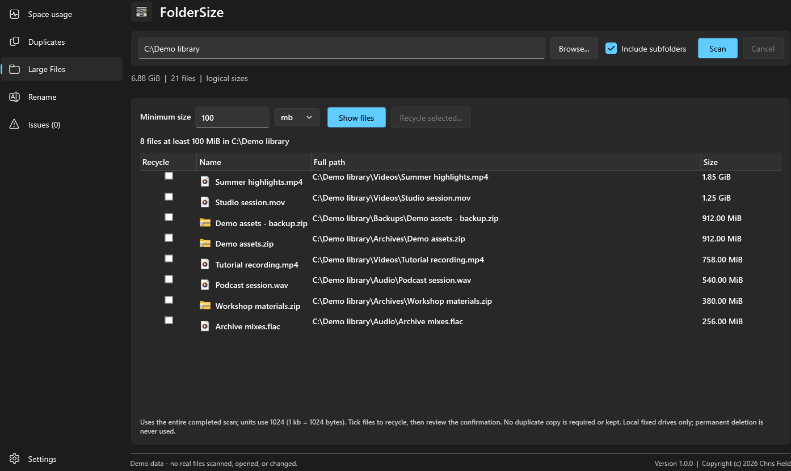
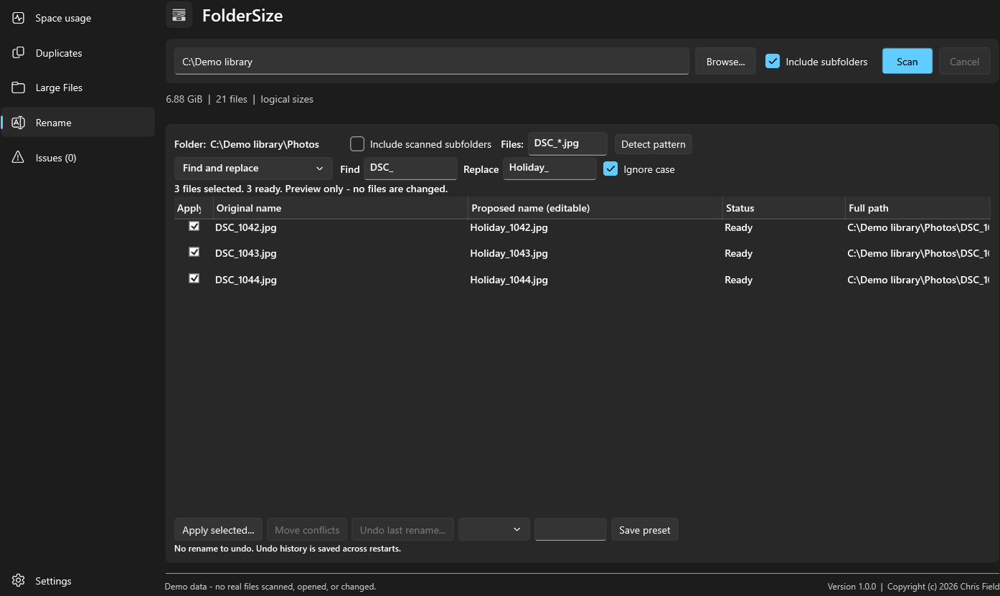
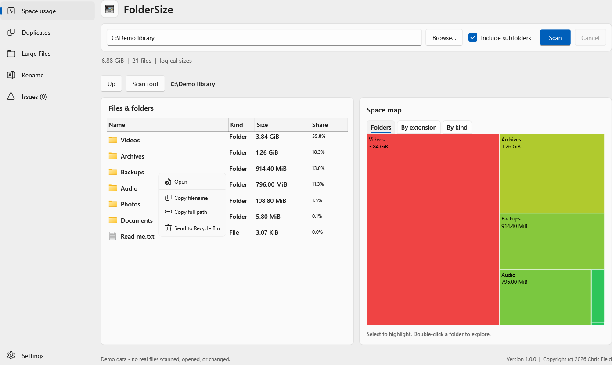

# FolderSize

A lightweight Windows folder-size explorer built with C# and WPF. No browser engine, database, background service, or administrator access is required.

The interface uses Microsoft's built-in WPF Fluent theme, supports Windows light/dark mode and accent colour, and keeps native keyboard navigation and virtualised file lists. A left navigation menu switches between **Space usage**, **Duplicates**, **Large Files**, **Rename**, and **Issues**, with **Settings** pinned at the bottom. Items have icons, rounded selection backgrounds, and an accent indicator. At narrow window widths it becomes an icon rail with tooltips; use arrow keys to navigate. Switching views preserves their state.

## Screenshots

These illustrative screenshots use the real interface with fictional, in-memory files, sizes, duplicate groups, and rename previews. No real files were scanned, opened, or modified to create them.

### Space usage and treemap

See which folders consume the most space, with sorted sizes and an interactive, colour-coded space map.



<details>
<summary>More features: duplicates, large files, renaming, and context menus</summary>

### Exact duplicates

Review duplicate groups, their extra logical bytes, and the copies selected for recycling.



### Large files

Filter the completed scan by minimum size and review the largest files across subfolders. Shown in dark mode.



### Rename previews

Preview original and proposed filenames before applying a rename rule. Shown in dark mode; this example changes no files.



### Fluent context menus

Open an item, copy its filename or full path, or send it to the Recycle Bin using the icon-based context menu.



</details>

## Settings

The main window remembers its size and screen position when you close it normally, stored in the same settings file. Maximised windows reopen maximised, preserving their previous normal size; minimised windows never reopen minimised. Windows adjusts a saved position that is completely off-screen after a monitor is disconnected or the display layout changes. Existing settings without window bounds keep the default size and position.

Select **Settings** at the bottom of the left menu to open preferences inside the main window. Choose **System**, **Light**, or **Dark** and configure **Open with Double Click** and **Start scanning when app is opened**. System is the default and follows Windows. Changes apply immediately to the app and its dialogue boxes and are saved automatically in `%LOCALAPPDATA%\FolderSize\settings.json`, including when the app is launched from Explorer or a portable folder. Select another menu item when finished; there is no separate Save button. Settings are unavailable during an operation.

If settings cannot be saved, the previous choices are retained and the Settings page displays the error. Invalid or unreadable settings produce a startup warning and use defaults for that session without silently overwriting the saved file.

**Open with Double Click** is enabled by default, including for existing settings files. Double-clicking a file in Files & folders, Duplicates, or Large Files opens it using its Windows default action. Turn the setting off to prevent file opening; double-click folder navigation is unaffected. Recycling checkboxes do not open files. Known executable, script, installer, and shortcut types, file types Windows marks dangerous, and files beginning with an executable MZ signature are refused. Missing files and launch failures show an error. This is not a security sandbox: Windows associations and opened documents can themselves run code.

**Start scanning when app is opened** is enabled by default, including for existing settings files. On every launch, the app scans the folder supplied by Explorer or the command line, or the folder shown in the path box (your user folder on a normal launch). Turn it off to open without scanning; choose **Scan** when ready. Changes affect future launches, not a scan already in progress.

## Run

Use Windows 11 x64, or Windows 10 22H2 x64 with the applicable Windows servicing/ESU requirements for .NET 10. Install the **[.NET 10 Desktop Runtime (x64)](https://dotnet.microsoft.com/en-us/download/dotnet/10.0)**, not just the base .NET or ASP.NET runtime.

### Windows installer

The **Windows installer** GitHub Actions workflow runs only when started manually using **Actions > Windows installer > Run workflow**. Pushes, tags, and pull requests do not trigger it. Choose the branch or ref to build. After a successful run, download `FolderSize-<version>-win-x64-Setup.exe` directly from the repository's **Releases** page. The same installer is also available in the `FolderSize-win-x64-installer` Actions artefact.

The installer bundles the .NET Desktop Runtime, installs for the current user under `%LOCALAPPDATA%\Programs\FolderSize` by default, creates a Start menu shortcut, and registers **Scan with FolderSize** for folders and folder backgrounds. No administrator access or separate .NET installation is needed. On Windows 11, the Explorer command appears under **Show more options**.

Remove it through Windows **Installed apps** (or **Apps & features**). Uninstall removes the installed files, shortcut, and Explorer entries, but preserves settings, rename presets, and undo history in `%LOCALAPPDATA%\FolderSize`. Reinstalling uses the same application identity and updates the existing installation. Installer registration replaces any manual FolderSize registration; uninstall does not restore old portable paths.

Release versions start at `1.0.0` when no version tags exist. Each run takes the highest existing numeric `vMAJOR.MINOR.PATCH` tag (also recognising older `.REVISION` tags) and increments its patch number: `v1.0.0`, `v1.0.1`, `v1.0.2`, and so on. The app, its displayed version, and the installer all use that release version; no version-bump commit is required. Release runs are serialised to prevent competing builds from choosing the same version.

The workflow compiles with Inno Setup 6.7.4 and smoke-tests installation, bundled runtime files, exact Explorer commands, and uninstall clean-up on a disposable Windows runner. Only after verification and artefact upload does it create a new tag for the exact built commit and publish a GitHub release with autogenerated notes and the installer attached. Existing tags are never overwritten. It requires the workflow token's `contents: write` permission; repository or organisation policy must allow it. Installers are unsigned, so Windows may show a SmartScreen warning.

To build locally, install [Inno Setup](https://jrsoftware.org/isinfo.php), then run:

```powershell
dotnet publish src\FolderSize.App -c Release -r win-x64 --self-contained true -o artifacts\FolderSize-installer-win-x64
& 'C:\Program Files (x86)\Inno Setup 6\ISCC.exe' /DAppVersion=1.0.0 installer\FolderSize.iss
```

### Portable app

Extract `artifacts\FolderSize-win-x64.zip` and run `FolderSize.exe` inside the extracted folder. Keep its accompanying files together. This portable build requires the .NET 10 Desktop Runtime described above.

### Manual Explorer right-click menu (portable app)

1. Publish the current app using VS Code's **publish** task or the command below.
2. Double-click `Explorer-Install.reg` and approve importing the entries. It adds **Scan with FolderSize** for both a folder and empty space inside a folder, for the current user only.
3. Right-click a folder, or empty space in an open folder, and choose **Scan with FolderSize**. On Windows 11, use **Show more options**.

The registration points to `G:\Dev\FolderSize\artifacts\FolderSize-win-x64\FolderSize.exe`. If you move the app, edit the executable paths in `Explorer-Install.reg` (preserving doubled backslashes and escaped quotes), then import it again. The folder argument ends with `\.` so quoted drive-root paths also work correctly. Explorer/command-line arguments and folder-picker selections are normalised immediately, even with startup scanning disabled: a drive root appears as `G:\`, not `G:\\.`, and subfolders do not display the trailing `\.`. This does not start a scan or interfere with typing a path manually.

To remove the menu entries, double-click `Explorer-Uninstall.reg`. Neither file is applied by building or running the app.

You can also open a folder from the command line; scanning starts automatically when **Start scanning when app is opened** is enabled:

```powershell
& .\artifacts\FolderSize-win-x64\FolderSize.exe "C:\Some Folder"
```

## Explore space usage

Light and dark themes follow Microsoft's [Windows design principles](https://learn.microsoft.com/en-us/windows/apps/design/design-principles), using native WPF Fluent controls, softly layered panels, subtle borders, and readable primary/secondary text. Tables use native headers and selection states without alternating stripes or custom hover outlines. Navigation uses a subtle selected surface and a left accent indicator; the space map's local tabs retain their accent underline. Accent colour is reserved for important actions, selection indicators, and keyboard focus. These styles follow the selected appearance, including System mode.

1. Browse to a folder or paste its path, then select **Scan**. **Browse...** opens at the folder currently entered in the path box.
2. **Include subfolders** is enabled by default and your choice is saved automatically between sessions. Turn it off to measure immediate files only; subfolders will say **Not scanned**. If saving fails, the previous choice is restored and an error is shown.
3. Sort by clicking column headings. The initial order is largest first.
4. Double-click a measured folder in the list or treemap to open it. **Up** moves to its parent without starting a scan. Within the completed scan, it shows cached results. Outside the scan root, it selects the parent and clears the old results; choose **Scan** when ready to measure that folder. Before the first scan, **Up** uses the folder in the path box, including when launched from Explorer with automatic startup scanning disabled. At a drive/share root there is no parent. **Scan root** returns to the root of the current scan. Enter also opens a selected folder in the list.
5. Select an entry to highlight it in the treemap. Hover for its path and size. Tiny entries are combined into a labelled **Other** tile to bound drawing work; they remain individually available in the list.
6. **Cancel** stops scanning or duplicate discovery. Cancelled operations do not enable actions on incomplete results.

Right-click a row in **Files & folders**, **Duplicates**, or **Large Files** for **Open**, **Copy filename**, **Copy full path**, and **Send to Recycle Bin**, with Fluent icons. Actions apply only to the right-clicked item, not the recycling checkboxes. Open navigates measured folders like double-click and opens files with the same safety checks; explicit Open works even when double-click file opening is disabled. Recycling requires confirmation and refreshes results afterwards. Duplicate rows keep a verified copy. Folders require a complete recursive scan without Issues; their contents are rechecked before recycling the entire folder. Changed contents, links, unreadable entries, and unsupported drives are refused; permanent deletion is never used.

Mouse side buttons navigate folder history: **Back** (button 4 / XButton1) returns to the previous folder and **Forward** (button 5 / XButton2) revisits it. History is kept for the current app session and includes opening measured folders, Up, and Scan root. Opening a different folder after going back clears forward history. These buttons never start a scan: they reuse the current scan when possible, otherwise select the folder with empty results until you choose **Scan**. Navigation is disabled during an operation.

Sizes use binary units (KiB, MiB, GiB) and count logical file lengths, **not allocated disk space**. Sparse/compressed files, hard links, filesystem metadata, and the Recycle Bin can make physical usage different. In particular, path-based folder totals count each hard-linked path.

Hidden/system entries are included when accessible. Junctions and symbolic links are skipped. The **Issues** tab lists skipped, inaccessible, missing, or changing files. A folder with omitted entries is labelled partial; a scan can complete with issues.

The space map has three tabs. **Folders** (the default) shows the current folder's immediate files and aggregate subfolder sizes, with existing selection and folder navigation. **By extension** groups files by extension, ignoring case. **By kind** groups common extensions into Images, Videos, Audio, Documents, Archives, Apps & libraries, and Code & data; unrecognised extensions are Other, and extensionless files have their own group. Classification is extension-based, not content inspection. Both grouped views include all scanned descendants of the currently viewed folder, without counting folder totals twice; with recursion off only immediate files are included. Hover for sizes. Group tiles do not navigate or filter the file list. All three maps colour tiles by size within the displayed map: green for the smallest, through yellow, to red for the largest. Combined **Other** tiles use their aggregate size; equal-sized tiles share a colour, and maps where every tile has the same size use green. Empty files have no area.

The file list and Large Files results show Windows' default folder and associated file-type icons. Icons load in the background only for displayed rows, with a bounded cache; no thumbnails or per-file custom icons are loaded. Restart the app after changing Windows file associations to refresh cached icons.

Map labels use black text for WCAG AA normal-text contrast (at least 4.5:1) across the green-to-red palette, including red tiles, in both light and dark themes.

## Large files

After scanning, select **Large Files** in the left menu, enter a minimum size, choose **kb**, **mb**, **gb**, or **tb**, and select **Show files** or press Enter. The default is 100 mb. Decimal and zero thresholds are supported, using your Windows decimal separator; negative, invalid, or oversized values show a validation message.

Results include files **equal to or larger than** the threshold from the entire completed scan, not just the currently viewed subfolder. Recursive scans include scanned descendants; nonrecursive scans include only immediate files. This filters existing metadata without rereading file contents or rescanning disk. Results show full paths and logical sizes, largest first, with sortable columns. Units use powers of 1024, matching the rest of the app (1 kb = 1024 bytes). Changing the threshold or starting another scan clears old results; select Show files to refresh.

To recycle large files, tick their **Recycle** checkboxes (none are selected by default), then choose **Recycle selected...**. Review the full paths, count, and total logical size in the confirmation; Cancel is the default action. Unlike duplicate clean-up, this does **not** check for or preserve another copy. Files with a changed size or modification time since scanning are skipped and reported under Issues. Uses the same local-fixed-drive, Recycle Bin-only safeguards as duplicate recycling, with no permanent-delete fallback. After an attempt, the original scan scope and current large-file filter are refreshed, selections are cleared, and stale duplicate results are discarded. Cancellation stops between files; already recycled files stay in the Recycle Bin.

## Bulk rename

Select **Rename** in the left menu. It uses the folder currently viewed under Space usage and the existing completed scan. **Include scanned subfolders** is off by default; enabling it includes only descendants that were actually scanned. Filter names with `*`, `*.pdf`, or multiple patterns such as `*.txt;*.jpg`.

**Detect pattern** analyses the filtered filenames locally, without reading file contents, using an online service, or changing files. It offers up to 12 suggestions with match counts, change counts, and example results. It recognises numbered series, volume/issue labels (`Vol`, `Volume`, `No`, `N`, `Issue`), clear year-first dates, underscores/double spaces, and title-case clean-up. Structural suggestions need at least two matching filenames and one actual change. Separate series can produce separate suggestions; invalid or ambiguous date groups are not guessed. Suggestions keep descriptive trailing text and file extensions rather than discarding them. Select **Use suggestion** to load a rule into the editable live preview; review unmatched files and conflicts before **Apply selected...**. Cancel leaves the current rule alone. Detection respects the current folder, filter, scanned-subfolder setting, and moved-conflict exclusions. Changing that scope or rule cancels stale detection work. Detected rules can be edited and saved as ordinary presets. Suggestions are heuristic, not a guarantee of the intended naming convention.

Choose a general-purpose rule:

- **Find and replace:** literal text replacement, optionally ignoring case. Leave replacement empty to remove text.
- **Capitalisation:** title case, lowercase, or uppercase.
- **Numbering:** prefix, non-negative starting number, and padding (1–12 digits). Numbering follows original full-path order, not the table's display sort.
- **Extract and format:** a regular expression with named groups and an output template. For example, pattern `^(?<label>.*?)_(?<number>\d+)$` and format `{label} - {number:000}` change `Invoice_12.pdf` to `Invoice - 012.pdf`. `{name}` is the original base name; `{n:000}` is a sequence number. Custom group names can represent any parts of a filename. Regular expressions have a timeout; invalid patterns and templates produce an error rather than applying guesses.

Rules operate on base names; **extensions are preserved**, including when manually editing proposals. Preview updates automatically after a short typing pause. Edit **Proposed name**, tick/untick **Apply**, and review statuses. Changing a rule, scope, or filter regenerates proposals and selections. Ready changes are initially checked; conflicts, unmatched files, invalid Windows names, and unchanged names are not. You can manually correct an unmatched proposal. **Any conflicting destination in the preview blocks the entire Apply action, even if the conflicting rows are unchecked.** A conflict message appears above the list. Resolve conflicts by editing proposals or changing the rule/filter; unchecking them does not bypass the block. Destination comparisons ignore case and include the folder, so identical names in different folders are allowed. Existing files or folders are never overwritten, including other selected source files; swaps and rename cycles must be done as separate operations.

**Move conflicts** is a separate operation to use before applying renames. It moves every file marked as a conflict, including unchecked rows, using its current filename rather than the proposed name. The folder prompt defaults to a `Conflicts` subfolder of the currently viewed rename folder; you can type another full path or browse, and missing folders are created. Existing files are never overwritten: numeric suffixes such as ` (1)` are added only when necessary to keep every file. Cancel is the default. Changed, missing, linked, or unreadable files are skipped and reported under Issues. Results are rescanned, clearing stale duplicate/large-file results. Successfully moved destination paths are excluded from rename previews for the rest of the app session, including recursive previews, so they do not immediately cause conflicts again. These moves do not apply the rename rule and are not included in **Undo last rename**; existing rename undo history is retained. Move the files back separately if needed.

**Apply selected...** shows the exact old and new names for confirmation, with Cancel as the default. Nothing is renamed by changing rules or viewing previews. Files whose size or modification time changed since scanning are skipped; links/junctions and unreadable files are refused. Renames stay in the same folder and do not read file contents. Results are rescanned afterwards, and stale duplicate/large-file results are cleared.

**Undo last rename...** previews restoring the previous names and works after restarting the app, even before a new scan. It verifies file identity, size, and modification time and refuses to overwrite an occupied original name. Modified, replaced, missing, or blocked files are reported under Issues; unresolved entries remain available for retry. Applying a new batch replaces the previous undo history after confirmation. Cancellation stops between moves; a saved pre-operation journal allows Undo to reconcile partially applied batches after interruption. Undo is not a backup or protection against external concurrent changes.

Load saved rules using the preset dropdown. Enter a preset name and select **Save preset** to save or replace it. Presets and undo history are stored alongside settings in `%LOCALAPPDATA%\FolderSize\rename-presets.json` and `rename-undo.json`. A lock prevents simultaneous rename operations from overwriting one another's history. Unreadable/corrupt undo history disables Apply/Undo with an explicit error; preserve or repair/remove that file, then scan again to reload history.

## Exact duplicates and safe recycling

- Select **Duplicates > Find duplicates** after a complete scan. This uses the same folder and recursion scope as the scan, not any subsequently edited path/toggle.
- Candidates are grouped by length. For large files, SHA-256 fingerprints of three 4 KiB samples (beginning, middle, and end) first rule out obvious differences. Only matching sample groups proceed to full streamed SHA-256 hashing and byte-for-byte verification. Files of 12 KiB or less are hashed directly without an extra sampling pass. Samples only reject candidates; they never establish equality. File identities prevent hard links to the same underlying file being counted as independent copies.
- Hashing and independent verification groups use up to eight concurrent readers (limited by logical processor count). Reference files stay locked during group verification; small reference contents are buffered once rather than reread for every copy. Discovery order and hard-link handling stay deterministic. No persistent hashes are trusted across scans.
- Duplicate results show full paths, group numbers, copy counts, and extra logical bytes. These bytes are **not guaranteed recoverable disk space**.
- All copies except the first result in each group are selected automatically using the **Recycle** checkboxes. The first is based on discovery order, not file age. Review the selection before recycling; keep at least one file in every group.
- **Invert selection** toggles every duplicate file's checkbox, including files outside the visible rows. **Clear selection** unchecks everything. Inversion can select an entire group; recycling remains blocked until at least one copy per group is unchecked.
- **Recycle selected...** presents all selected paths and a logical-byte total for confirmation. Cancel is the default.
- Before each operation, the app reopens the retained copy and target, checks their identity/metadata, and compares their contents again. The retained copy is locked against writes/deletion while recycling.
- Recycling uses Windows Shell `IFileOperation` with `FOFX_RECYCLEONDELETE` and a callback that vetoes non-recycling deletion. Only local fixed drives are eligible. Unsupported locations or failures are reported; there is **no permanent-delete fallback**.
- A failed verification/recycle stops that group; other groups can proceed. Cancellation stops between operations. The scan and duplicate results refresh afterwards, including after partial success. Refresh failure leaves duplicate actions disabled until another successful scan.

Recycling does not free disk space until you empty the Recycle Bin separately. Restore recycled files using Windows' Recycle Bin.

All results are filesystem snapshots. The Shell requires the target handle to be released before recycling, so external concurrent path replacement cannot be made fully atomic with verification. Do not use this as an adversarial/race-proof clean-up tool or modify files during clean-up. Network volumes, junctions/symlinks, and files whose identity cannot be read are not eligible for recycling.

## Build and test

Install the [.NET 10 SDK](https://dotnet.microsoft.com/en-us/download/dotnet/10.0) on Windows.

### Visual Studio Code

Full Visual Studio is not required.

1. Open this project's root folder in VS Code (the folder containing `FolderSize.slnx`).
2. Install Microsoft's **C#** extension (`ms-dotnettools.csharp`), offered in the workspace recommendations. The .NET 10 **SDK**, not just the runtime, must be installed and `dotnet` available on your PATH. Restart VS Code after installing the SDK if necessary.
3. Press **Ctrl+Shift+B** to restore dependencies and build the solution in Debug mode.
4. Press **F5** and choose **FolderSize** to build and debug the app. **Ctrl+F5** runs it without debugging.
5. Use **Terminal > Run Task > test** for the fast tests (excludes real recycling and the large performance fixture).
6. Use **Terminal > Run Task > publish** for the Release portable folder at `artifacts\FolderSize-win-x64`. ZIP creation is a separate command below.

Build errors appear in VS Code's **Problems** panel. WPF runs on Windows; these tasks are intended for a local Windows workspace, not WSL or a Linux container. VS Code can edit XAML but does not include Visual Studio's visual WPF designer.

### Command line

```powershell
dotnet build FolderSize.slnx -c Release
dotnet run --project src\FolderSize.App

# Fast tests, including WPF interaction tests; no real recycling
dotnet test tests\FolderSize.Tests -c Release --filter "Category!=Performance&Category!=RecycleIntegration"

# Real Shell integration: recycles one tiny, uniquely named disposable fixture file
dotnet test tests\FolderSize.Tests -c Release --filter "Category=RecycleIntegration"

# Creates/removes large scan and duplicate fixtures and reports local performance measurements
dotnet test tests\FolderSize.Tests -c Release --filter "Category=Performance" --logger "console;verbosity=detailed"

# Complete suite, including both opt-in categories above
dotnet test tests\FolderSize.Tests -c Release
```

WPF tests display temporary windows and require an interactive Windows desktop. Tests create uniquely named `FolderSize-tests-*` folders in the current user's temporary directory and clean them afterwards. The recycle integration fixture remains in the Windows Recycle Bin. Performance depends on storage, cache state, antivirus, directory layout, and file count; duplicate discovery also depends on total candidate content size.

One local Release run with 100,000 one-byte files in a single directory measured 0.315 seconds for scanning plus initial UI display, 12 realised list rows, a 139.6 ms maximum UI timer gap, and 4.2 ms in-flight traversal cancellation. Peak working set was 219.5 MiB **for the testhost**, including WPF and fixture creation, not the standalone application's baseline.

Controlled core-only benchmarks on the same local fixtures, using a warm-up and the median of three runs, measured these changes:

| Workload | Before | After | Managed allocation before / after |
| --- | ---: | ---: | ---: |
| Scan 100,000 immediate files | 100.1 ms | 31.2 ms | 57.70 / 14.97 MiB |
| Scan 100,000 files in 250 subfolders | 87.5 ms | 60.4 ms | 58.02 / 14.41 MiB |
| Find 40 duplicate groups among 4,000 1 KiB files | 15,233.4 ms | 2,333.3 ms | 588.96 / 64.80 MiB |
| Find 32 duplicate groups among 96 1 MiB files | 429.4 ms | 78.8 ms | 7.98 / 1.64 MiB |

Traversal consumes enumeration metadata directly without allocating a `FileInfo` per entry, using a 64 KiB enumeration buffer. File-content reads use pooled buffers without an additional per-stream 64 KiB buffer. These are local, warm-cache observations, not cold-disk measurements or performance guarantees. Disk type, antivirus, path depth, cache state, and other activity affect results; concurrent reads can be less beneficial on rotational or network storage.

### Portable framework-dependent ZIP

```powershell
dotnet publish src\FolderSize.App -c Release -r win-x64 --self-contained false -o artifacts\FolderSize-win-x64
Compress-Archive -Path artifacts\FolderSize-win-x64\* -DestinationPath artifacts\FolderSize-win-x64.zip -Force
```

This intentionally does not bundle .NET, trim WPF, or publish a single-file executable. The portable ZIP needs the x64 .NET 10 Desktop Runtime already installed.

## Structure and limits

- `src\FolderSize.Core`: cancellable metadata traversal, compact result tree, duplicate verification, recycling policy, Windows file identity, and squarified treemap layout.
- `src\FolderSize.App`: WPF view/view model, virtualised grids, bounded custom-drawn treemap, and Shell recycling integration.
- `tests\FolderSize.Tests`: scan/error tests, duplicate/deletion safeguards, layout invariants, WPF interaction, real recycling, and a 100,000-file performance fixture.

Traversal runs in a background worker; duplicate hashing and verification use bounded concurrency, at most 16 open file leases, and streamed reads. Custom `IFileAccess` implementations remain sequential unless they opt into `SupportsConcurrentReads`. The file tree and duplicate metadata stay in memory, so memory consumption still grows with entry count. There is no MFT indexing, persistent cache, live watching, allocated-size accounting, permanent deletion, or automatic clean-up.

## Copyright

Copyright (c) 2026 Chris Field

The application's code is licensed under the [MIT License](LICENSE). Third-party artwork retains its separate licence described below.

The main window's bottom status bar shows the app's build version and copyright notice on every page.

## Icon attribution

The app uses OpenMoji's ["card file box" (1F5C3)](https://openmoji.org/library/emoji-1F5C3/), designed by Sina Schulz, under [CC BY-SA 4.0](https://creativecommons.org/licenses/by-sa/4.0/). The original colour PNG was resized and converted to a multi-resolution Windows icon. The artwork and converted icon retain that licence; this attribution does not license the application's code. See [THIRD-PARTY-NOTICES.txt](THIRD-PARTY-NOTICES.txt), also included in build and publish output.
